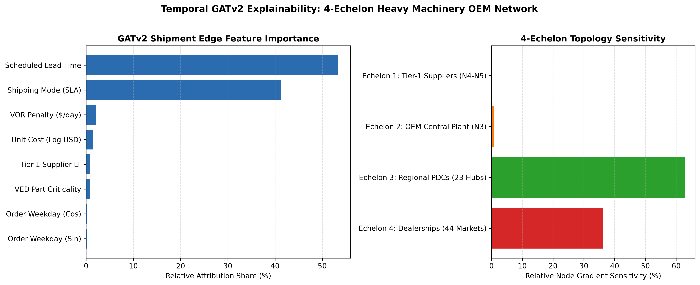
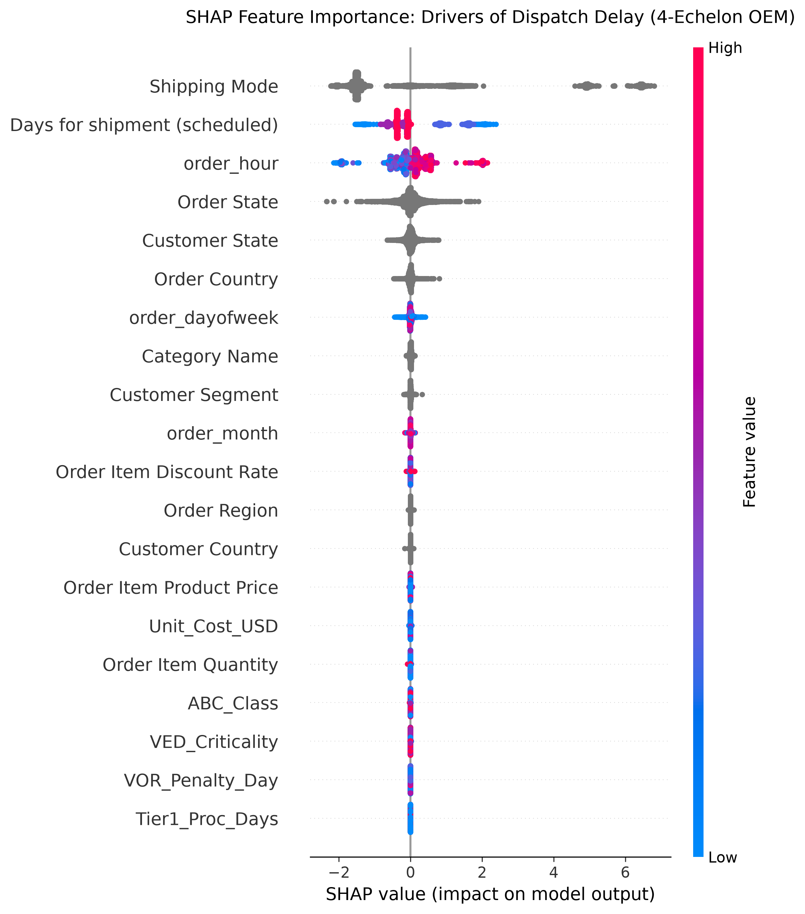

# Multi-Echelon OEM Supply Chain Disruption Modeling with Graph Neural Networks

Predictive lead-time modeling, asymmetric Vehicle-Off-Road (VOR) cost optimization, and counterfactual shock stress-testing across a **70-node, 4-echelon heavy-machinery aftermarket network** (`2 Tier-1 Suppliers -> 1 OEM Central Plant -> 23 Regional PDCs -> 44 Dealerships`).

## Benchmark Results (Held-Out Chronological Test Set: 27,075 Shipment Edges)

| Model | Topology | Clf Acc | ROC-AUC | Reg MAE (d) | Reg RMSE (d) | Reg R² | Vital MAE (d) | VOR Cost Saved | Cost Reduction |
| :--- | :--- | :---: | :---: | :---: | :---: | :---: | :---: | :---: | :---: |
| **Static ERP Baseline** | Fixed Schedule ($27.21M) | — | — | — | — | — | — | $0 | 0.00% |
| **LightGBM (Tabular)** | Point-in-Time Features | **71.50%** | **0.7809** | **0.9800** | — | **0.2758** | — | — | — |
| **Static GNN (GraphSAGE)** | 70-Node 4-Echelon Graph | 70.07% | 0.7188 | 1.0476 | 1.3159 | 0.2244 | 1.032 | **$11,347,250** | **41.70%** |
| **Temporal GATv2 (3-Hop)** | 70-Node Bidirectional Graph | 70.07% | 0.7185 | **1.0419** | **1.3114** | **0.2297** | **1.025** | $11,205,914 | 41.18% |

## Counterfactual Stress-Testing Summary

- **Scenario 1 — Regional PDC Capacity Bottleneck (Node 25, 12,350 Orders):** SLA saturation induces up to a **+1.095-day** delay spike (`+0.063 d` mean positive shift), creating **$813,248.25** in incremental VOR risk and raising Vital-part (`AV`/`BV`) Reorder Points by **+19.0 units** (`75.26 -> 94.31` units at 99% CSL).
- **Scenario 2 — Upstream OEM Plant & Tier-1 Shock (+6.0d GSM Coupling):** End-to-end Time-to-Recover (`TTR`) reaches **9.44 days** mean (`10.05 days` 90th percentile), breaching the **9.0-day** forward buffer (`TTS`) across all **44 / 44 dealerships** (`46.0 dealer-days` cumulative tail exposure).

## Model Explainability





## Reproduction Order

```bash
python -m src.data.audit
python -m src.data.oem_echelon_builder
python -m src.data.build_oem_graph
python -m src.models.tabular_baseline
python -m src.models.static_gnn
python -m src.models.temporal_gnn
python -m src.evaluation.stress_testing
python -m src.explainability.explainers
```